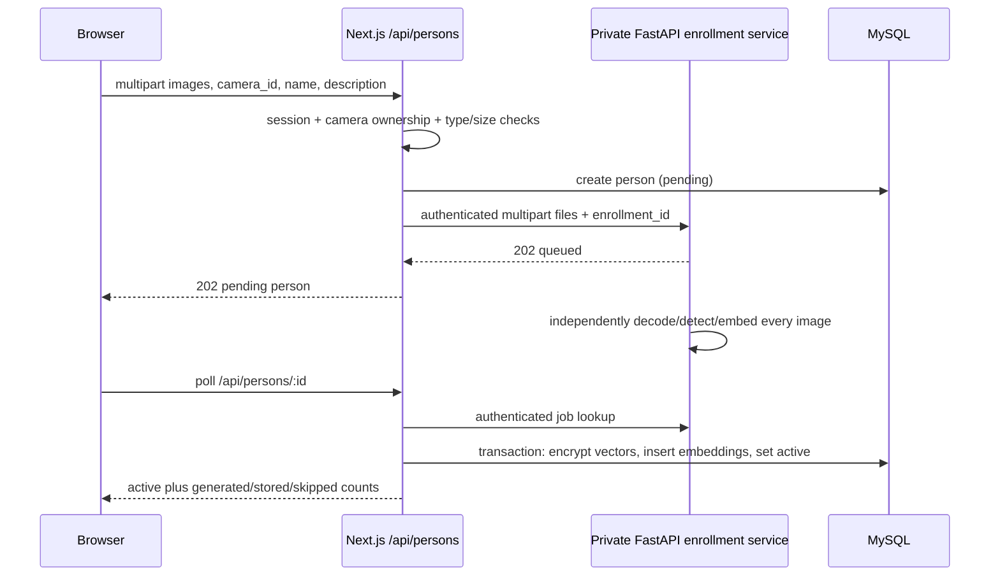
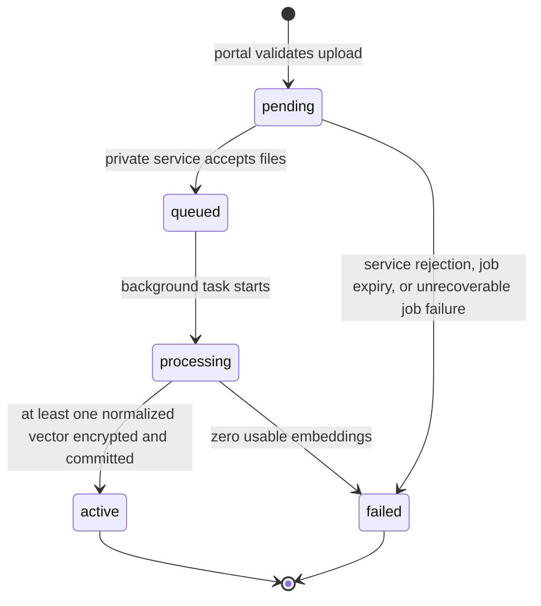
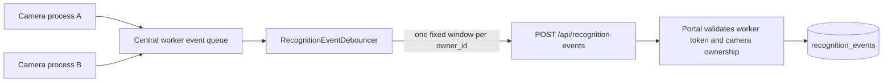
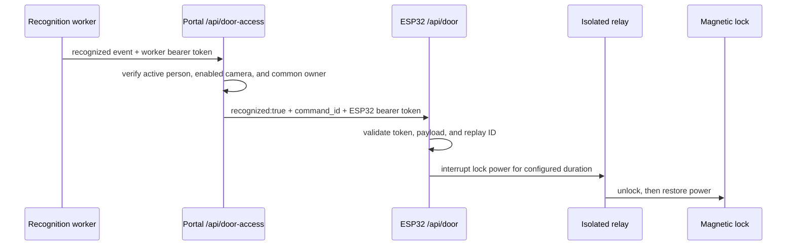

# Project structure

## Components

```text
Home_Security_Face_Recognition/
├── webpage/                         # Next.js 16 portal and server API
│   ├── app/
│   │   ├── cameras/[cameraId]/       # Camera detail, logs and enrollment UI
│   │   │   └── people/new/
│   │   │       ├── page.tsx          # Validates the route camera ID
│   │   │       └── PersonEnrollment.tsx # Browser upload and job polling
│   │   └── api/
│   │       ├── persons/route.ts      # Owner-scoped people list and enrollment start
│   │       ├── persons/[id]/route.ts # Owner-scoped job polling, encryption and persistence
│   │       ├── worker/               # Worker camera and identity APIs
│   │       └── recognition-events/   # Worker event intake
│   ├── lib/
│   │   ├── auth.ts                   # Session token/session user lookup
│   │   ├── db.ts                     # Only MySQL access layer
│   │   ├── biometric-crypto.ts       # AES-GCM embedding encryption/validation
│   │   ├── worker-auth.ts            # Database-backed worker credential checks
│   │   ├── private-service-url.ts    # Trusted enrollment-service URL validation
│   │   └── logger.ts                 # Redacted JSON server logging
│   ├── proxy.ts                      # Page/API session gate; excludes /api/persons uploads
│   ├── next.config.ts                # Next configuration
│   └── tests/                        # Node regression tests
└── recognization_code/               # Python recognition and private enrollment service
    ├── enrollment_service.py          # FastAPI upload/job API and per-image embedding work
    ├── face_engine.py                # Existing ONNX detector/recognizer and identity index
    ├── main.py, pipeline.py           # RTSP recognition worker and event handoff
    ├── recognition_event_debouncer.py # Per-user fixed-window latest-event delivery
    ├── config.py                     # Worker/service settings
    └── test_*.py                     # Worker and enrollment regression tests
├── esp32/
│   ├── door_controller.py             # MicroPython authenticated relay HTTP controller
│   └── config.example.py              # Safe Wi-Fi/relay configuration template
```

`recognization_code/backend/` is the older standalone FastAPI/SQLAlchemy event UI backend (`main.py`, `models.py`, `schemas.py`, and `database.py`). The production portal ownership and biometric persistence path is the Next.js/MySQL layer described below.

## Enrollment flow



The browser never supplies a user ID. `app/api/persons/route.ts` obtains the session user server-side, validates that `camera_id` belongs to that user, then inserts a `persons` row in `pending`. It forwards files with a fresh `FormData`; it deliberately does not set a multipart `Content-Type`, allowing the runtime to supply its matching boundary. The enrollment service uses its independent bearer token. Raw images are only held in memory.

`proxy.ts` intentionally excludes `/api/persons` and `/api/persons/:id`: in Next.js 16, a matched Proxy clones/buffers request bodies (default 10 MB), which corrupts larger multipart streams before `Request.formData()` runs. The API routes perform their own session validation, so this exclusion does not bypass authentication or ownership authorization.

## Job lifecycle and failure rules



`enrollment_service.py` accepts 1–10 JPEG/PNG/WebP files, each at most 8 MB. It verifies MIME/bytes/duplicates before queuing. During processing, corrupt images, invalid dimensions, zero/multiple/too-small faces, and per-image detector/alignment errors become skipped images; remaining images continue. A completed job includes only normalized 512-dimensional embeddings and counters such as `images_skipped`. If every image is skipped, it returns `failed` with no embeddings. The portal’s polling route validates dimensions and normalization again, encrypts each embedding with `FACE_EMBEDDINGS_ENCRYPTION_KEY`, inserts all rows and marks the person `active` in one MySQL transaction. A database transaction failure leaves the person pending and the completed job available for a safe retry; it never marks a person active without committed embeddings.

Worker identity loading is owner-scoped: `app/api/worker/person-embeddings/route.ts` joins embeddings only for the camera owner and only for active persons. `face_engine.py` uses the existing ONNX model and keeps database person IDs as identity keys.

## Recognition-event delivery and debouncing



`pipeline.py` emits the existing event payload after recognition/tracking decisions; it does not debounce and recognition thresholds are unchanged. In portal mode, `main.py` attaches the `owner_id` supplied by the authenticated `/api/worker/cameras` response as private worker routing metadata and sends all camera-process events to one parent-process queue. `recognition_event_debouncer.py` holds exactly one event and one monotonic fixed deadline per owner ID: the first event starts the window, later events replace the payload without extending that deadline, and the latest payload is posted at expiry. Thus every camera owned by one portal user shares a window, while different users remain independent.

The internal owner ID and local snapshot path are removed before the existing bearer-authenticated portal request. For an unknown event only, the worker's background delivery thread can attach a validated, bounded JPEG; the portal stores it privately outside public assets, keeps only an opaque key in MySQL, and serves it through a session-authenticated camera-owner check. The portal continues to derive the owner from `camera_id` in MySQL and verifies person ownership; the worker never supplies an authoritative user ID.

The debouncer uses a lock, monotonic deadlines, and per-state generation numbers. HTTP delivery happens outside the lock. If a new event arrives while an old one is being posted, it installs a new generation/window; the old completion cannot clear or retry over it. Transient connection, timeout, invalid-response, and HTTP 5xx failures retry the newest pending event at 1, 2, then 4 seconds (three retries maximum). HTTP 4xx failures are permanent. A new event while a retry is pending replaces the retry payload but retains its retry time, so a failed delivery never restarts the normal 120-second window. At process shutdown the worker stops intake and makes one best-effort final delivery per remaining user; no local durable queue exists, so a process crash can still lose pending events.

## Immediate ESP32 door access



Door access is intentionally separate from notification/history debouncing. On each newly emitted `recognized` tracking event, `recognization_code/main.py` immediately posts to `POST /api/door-access`; unknown events never call it. The endpoint uses the existing database-backed worker credential and requires a finite similarity at or above `DOOR_ACCESS_MIN_SIMILARITY` (default `0.45`). `webpage/lib/door-access.ts` then derives authorization exclusively from MySQL: the camera must be enabled and the recognized person must still be active and owned by that camera's owner. Consequently every active enrolled person belonging to the camera owner is eligible, while unknown, inactive, deleted, and cross-owner persons are rejected; no manual person-ID allow-list exists. The worker's existing event ID is durably claimed once before becoming the idempotent `command_id`; duplicate events make no second controller request, and uncertain unlock calls are never retried automatically. Existing installations must apply `webpage/db/migrations/20261115_door_access_commands.sql` before enabling door access.

No ESP32 firmware existed previously, so `esp32/door_controller.py` is a standalone MicroPython server. It implements authenticated `POST /api/door`; invalid JSON/content type/fields return 400, bad or missing bearer authentication returns 401, and `recognized:false` is a no-op. A bounded in-memory replay cache prevents duplicate activation. It initializes the relay secure before Wi-Fi starts, releases it with non-blocking `uasyncio.sleep`, and never extends an active unlock window. Both portal and firmware defaults are disabled/simulated.

Keep the ESP32 only on a trusted LAN. Never connect the magnetic lock to ESP32 GPIO directly: use correctly rated isolated relay or access-control equipment, an independent lock supply, emergency egress, and a fire-alarm release. Verify the complete circuit's secure state through ESP32 reboot and power loss before enabling real relay operation.

Example test after copying `esp32/config.example.py` to the device as `config.py` and deploying `door_controller.py`:

```sh
curl -i http://ESP32_IP/api/door \
  -H 'Authorization: Bearer YOUR_ESP32_TOKEN' \
  -H 'Content-Type: application/json' \
  -d '{"recognized":true,"command_id":"manual-test-001"}'
```

Start with simulation enabled and inspect serial `[DOOR]` logs. Only a qualified installer should subsequently wire the relay contacts into the magnetic-lock power/control circuit.

## Unknown-person snapshots and IST display

Recognition event instants remain UTC in MySQL and API responses. The portal formats all user-facing event and camera-registration times with the explicit `Asia/Kolkata` IANA time zone. Unknown snapshots are captured as bounded JPEGs by the worker's background writer, then attached only when the worker's existing debounced event delivery runs. The portal stores the JPEG outside public/static files and records an opaque `snapshot_key`; `GET /api/recognition-events/:id/snapshot` requires a session and verifies ownership of the event's camera before returning the image. Apply `webpage/db/migrations/20261115_recognition_snapshots.sql` to existing databases before enabling snapshot uploads.

## Important APIs

| Endpoint | Responsibility |
|---|---|
| `POST /api/persons` | Session-authenticated multipart enrollment start; validates camera ownership and creates pending person. |
| `GET /api/persons` | Lists only the current user’s active people with embeddings. |
| `GET /api/persons/:id` | Polls the private job, then securely persists completed embeddings for its owner. |
| `DELETE /api/persons/:id` | Deletes an owner’s person and related embeddings. |
| `POST /v1/jobs` (private service) | Bearer-authenticated file intake and asynchronous job creation. |
| `GET/DELETE /v1/jobs/:id` (private service) | Bearer-authenticated job lookup/removal. |
| `GET /api/worker/cameras` | Authenticated worker configuration sync. |
| `GET /api/worker/person-embeddings` | Authenticated, owner-scoped encrypted identity data for a camera. |
| `POST /api/recognition-events` | Authenticated recognition event intake and ownership checks. |

## Environment variables

Portal: `DATABASE_URL`, `RECOGNITION_WORKER_TOKEN`, `CAMERA_SECRET_KEY`, `FACE_EMBEDDINGS_ENCRYPTION_KEY`, `ENROLLMENT_SERVICE_URL`, `ENROLLMENT_SERVICE_TOKEN`, `RESEND_API_KEY`, `DEMO_EMAIL_TO`, `LOG_LEVEL`, `DOOR_ACCESS_ENABLED`, `DOOR_ACCESS_DRY_RUN`, `ESP32_DOOR_API_URL`, `ESP32_DOOR_API_TOKEN`, `DOOR_UNLOCK_TIMEOUT`, `DOOR_ACCESS_MIN_SIMILARITY`.

Recognition/enrollment service: `PORTAL_API_URL`, `RECOGNITION_WORKER_TOKEN`, `ENROLLMENT_SERVICE_TOKEN`, `PORTAL_SYNC_INTERVAL`, `IDENTITY_SYNC_INTERVAL`, `RECOGNITION_DEBOUNCE_SECONDS` (default `120`), `LOG_LEVEL`, plus model/camera settings defined in `recognization_code/config.py`. Never log or commit their values.

## Debugging enrollment

1. In browser DevTools, filter logs by `[ENROLLMENT]`. The component reports filenames, MIME types, byte counts, total size, form field names, request/poll status and safe API bodies—never image data, cookies, tokens, or vectors.
2. Inspect portal JSON logs (`component: "ENROLLMENT"`) using `requestId`. Upload logs record multipart type/length/boundary presence, parser errors, field names, per-file validation, camera authorization, private-service status and storage completion.
3. Inspect enrollment-service log events by `enrollment_id` and `request_id`: `image_decoded`, `face_detection_completed`, `image_skipped`, `embedding_generated`, and `enrollment_embeddings_generated` expose counts without biometric data.
4. For a multipart parser failure, verify the request remains browser-generated `FormData`, has `multipart/form-data; boundary=...`, and is sent to `/api/persons`. Do not manually set `Content-Type`. For uploads close to 50 MB, account for multipart framing overhead; the API rejects a declared or actual total over 50 MiB.

## Tests

Run portal checks from `webpage/`: `npm run typecheck`, `npm run lint`, and `node --experimental-strip-types --test tests/*.test.mjs` when supported by the installed Node version. Run recognition tests from `recognization_code/`: `python -m unittest test_enrollment_service.py test_identity_index.py test_worker_camera_loading.py test_recognition_event_debouncer.py`. The deterministic debounce tests use a controllable monotonic clock. Worker tests mock immediate door-access requests and prove unknown events make no access request. ESP32 code requires actual MicroPython hardware and was not physically tested here. Database-backed multi-user and RTSP integration require configured MySQL, model files, cameras, and service credentials; they are not simulated by these unit tests.
